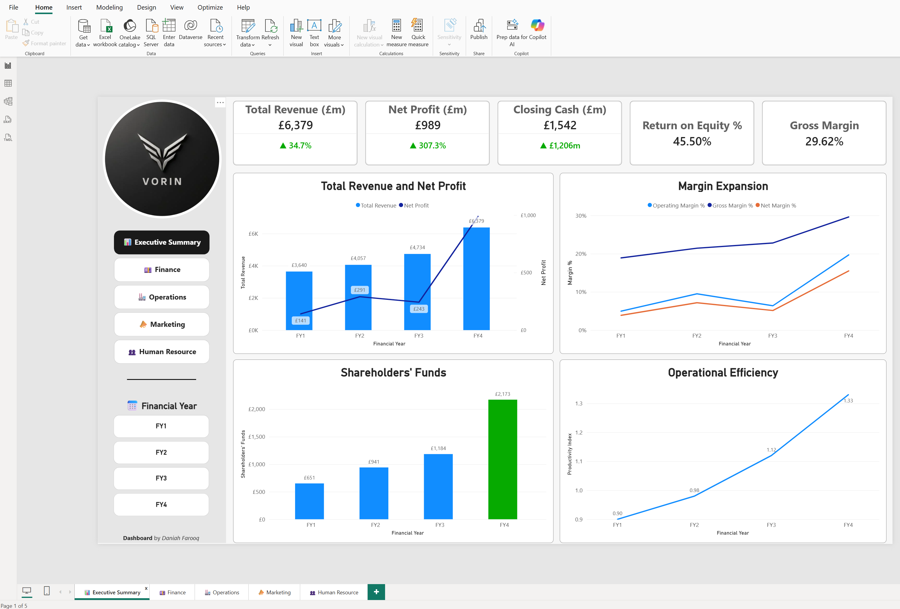
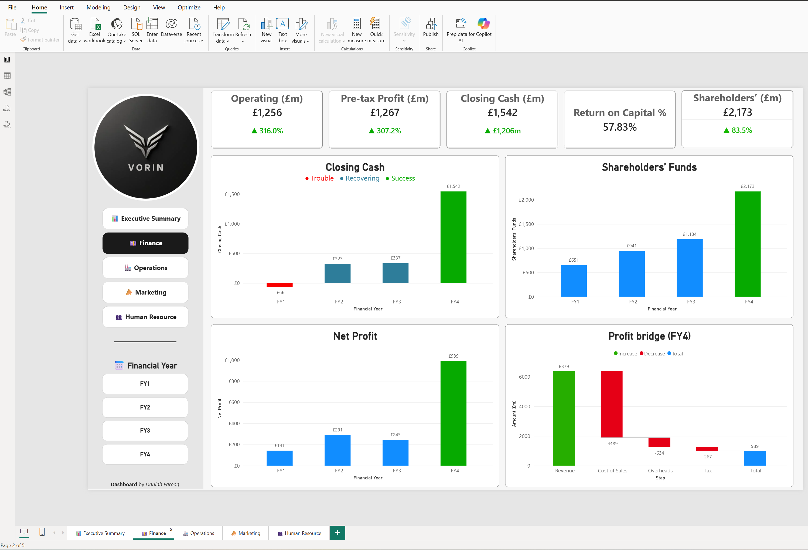
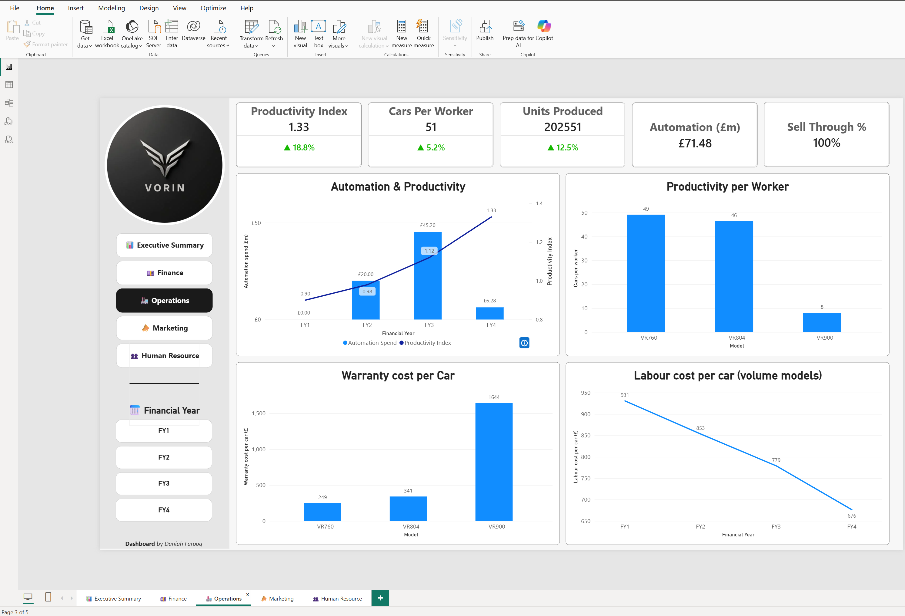
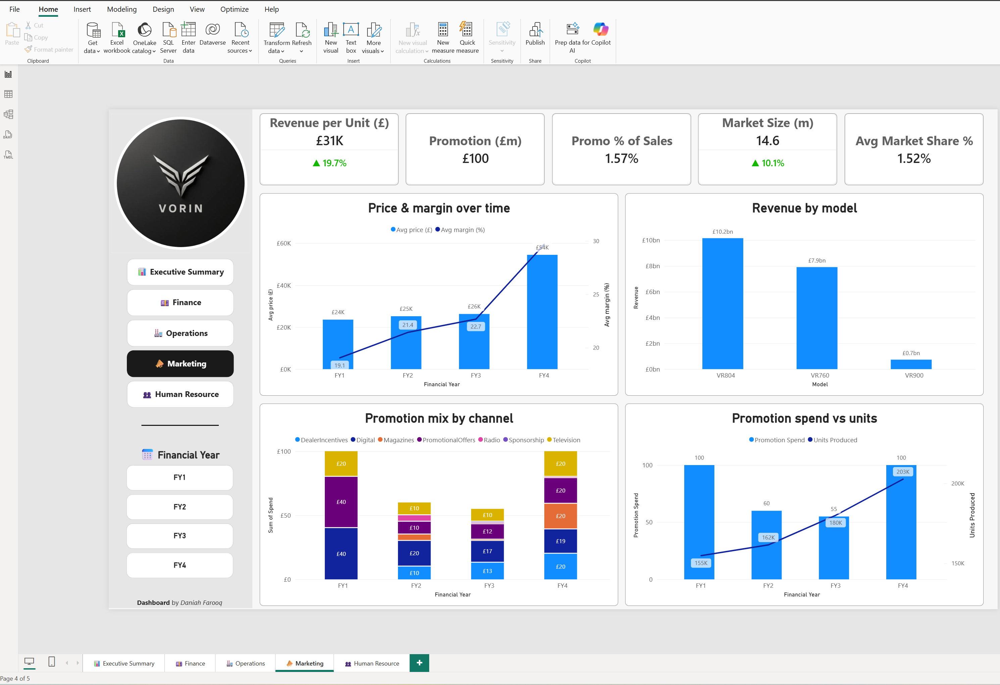
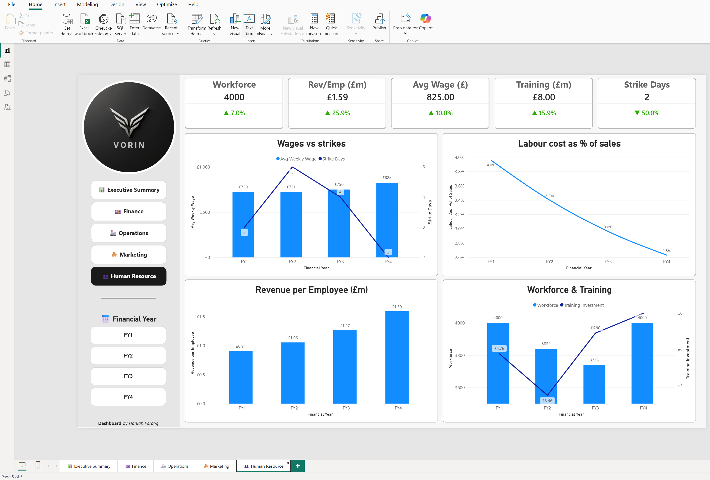

# VORIN Automotive Performance Dashboard

An end-to-end, five-page executive dashboard built in Power BI, analysing four years of performance for VORIN, a car manufacturer. The project takes raw annual company reports and strategic decisions and turns them into a connected, decision-ready story for senior leadership, tracking how the business grew from a marginal, cash-strapped position into a strongly profitable company.

The dashboard is designed the way leading organisations build executive reporting: a synthesising summary page for decision-makers, supported by dedicated pages for each core business function, all tied together with consistent navigation, honest metrics, and a clean visual system.

---

## Business context

VORIN is a European car manufacturer competing across the small, medium, large, and luxury segments. Over the four-year period analysed, the company:

- Grew revenue by 75 percent
- Multiplied net profit roughly sevenfold
- Moved from a cash overdraft to over 1.5 billion in reserves
- Launched a flagship luxury model that reshaped its profitability

The dashboard was built to answer the questions a board and department heads actually ask, and to make the drivers behind those results visible at a glance.

---

## How the dashboard is structured

The report follows a five-page architecture, navigated through a custom sidebar. Each page answers one clear question and pairs headline KPIs with a focused set of visuals.

### Executive Summary

The front page for leadership. It provides the company's vital signs in a single view: revenue and profit growth, margin expansion, growth in shareholders' funds, and the rise in operational productivity. The goal is for a senior stakeholder to understand the health and trajectory of the entire business within thirty seconds, then drill into any function for detail.

**What it shows:** Revenue up 75 percent and net profit up sevenfold, margins widening across gross, operating, and net, company value more than tripling, and productivity climbing steadily year on year. Together these establish that the growth was profitable, sustainable, and well managed.

### Finance

The profitability and solvency view. This page tracks the financial turnaround in depth, from the recovery in cash position to the growth in profit and equity, and closes with a revenue-to-profit waterfall that shows exactly how each pound of revenue converts into profit.

**What it shows:** A cash position that recovered from a deficit to strong reserves, net profit and shareholders' funds both climbing steeply, and a profit bridge revealing that cost of sales is the dominant draw on revenue, with the business retaining a healthy final margin. The page confirms the profits were real, liquid, and translated into genuine value for owners.

### Operations

The production efficiency view. This page connects cause and effect across the factory: how investment in automation drove productivity, how that flowed through to lower unit costs, and how the model mix balances mass-market efficiency against hand-built luxury quality.

**What it shows:** Automation investment lifting the productivity index from below par to well above it, warranty cost rising with build complexity across the model range exactly as expected, and labour cost per car on the volume models falling 27 percent as efficiency improved. The page demonstrates a factory that became measurably leaner while scaling output.

### Marketing

The customer and commercial view. This page examines whether the company won customers profitably, covering pricing power, the evolution of the promotional channel mix, revenue contribution by model, and marketing efficiency.

**What it shows:** Revenue per vehicle rising alongside margin, which is the clearest evidence of genuine pricing power, a promotional strategy that matured from a narrow, blunt approach into a balanced multi-channel mix, and marketing spend that fell as a share of sales even while revenue grew. The page shows a brand that earned the right to charge more and spent efficiently to do it.

### People

The workforce view. This page assesses whether the company built a productive and stable team, linking pay and training investment to engagement and output.

**What it shows:** Wages rising while strike days fell to their lowest level, revenue generated per employee increasing 75 percent, and labour cost falling as a share of sales despite higher pay. The page makes the case that investment in people translated directly into productivity and stability.

---

## Technical approach

**Data modelling.** A star-schema model with a central financial-year dimension linked to five fact tables covering financials, model-level production, annual decisions, promotional spend, and market size. The clean separation of dimension and facts keeps the model efficient and the relationships easy to reason about.

**DAX.** Over sixty measures, including year-on-year growth calculations and a set of current-state measures engineered so that headline KPI cards always display the latest year regardless of filter selection, while the supporting charts remain fully interactive across all years. This resolves a common design tension between a summary view and an exploratory one.

**Interactivity.** A financial-year slicer synchronised across every page, a custom navigation sidebar, and click-to-reveal insight panels built with bookmarks, so contextual commentary is available on demand without cluttering the canvas.

**Design system.** A consistent visual language throughout: a custom theme, a uniform KPI card format with conditional growth indicators, a branded sidebar, and a two-by-two chart grid on every page. The result reads as a single, coherent product rather than a collection of separate reports.

**Analytical judgement.** Metrics were chosen for accuracy and defensibility rather than visual drama. For example, pricing is measured as revenue per unit rather than a simple average price, so a single ultra-premium model does not distort the figure, and strike days are presented so that a reduction reads clearly as a positive outcome. Where a metric could mislead, the scope is stated explicitly.

---

## Tools

- Power BI Desktop for data modelling, DAX, visualisation, and interactivity
- Excel for source data preparation

---

## Skills demonstrated

- Dimensional data modelling and star-schema design
- Advanced DAX, including time intelligence and current-state measures
- Data preparation and transformation (Power Query)
- KPI definition and metric design
- Executive dashboard design and information hierarchy
- Interactive reporting with navigation, synced filters, and bookmarks
- Data storytelling and stakeholder communication
- Translating raw business data into clear, decision-oriented insight

---

*Designed and built by Daniah Farooq.*
